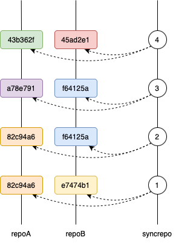

## Purpose

`banksync` is a command line tool, `bank`, that simplifies the use of git commands across a "bank" (a collection) of
repositories. It records the state of every repository in the bank in a *syncfile*, which lives in its own git repo,
the *syncrepo*. Each commit of the syncrepo is then a configuration of the whole bank, which you can check out again,
bisect, or share.



In simplistic terms each commit in the syncrepo corresponds to a configuration or state of the constituent repos.

`bank` is a looser alternative to git submodules: repositories are matched by sha, and if a sha no longer exists
(for example after a rebase or filter-branch) by commit timestamp, so a bank survives history rewrites that would
break a submodule.

## Installation

banksync needs Python 3.12 or later and git. Install it from PyPI with:

    pip install banksync

This installs the `bank` command (and the same command under the name `banksync`). Tab completion for bash and zsh
is available through [argcomplete](https://github.com/kislyuk/argcomplete):

    eval "$(register-python-argcomplete bank)"

## Quick Start

A bank is a collection of repos defined in a *syncfile*. The syncfile typically resides in a *syncrepo*. In this
example, we'll use a project called `animals` containing two repos: `repoFish` and `repoBird`. The project can be
placed anywhere, but for simplicity, we'll put it in the user's home directory.

To clone and populate the example collection of repos, use the following commands:

    cd ~
    bank clone https://github.com/testbank/animalsSyncRepo.git animals

This git clones the thin syncrepo, which contains the syncfile, and then clones each of the constituent repos and
checks out the revisions recorded in the syncfile. The resulting structure is:

    animals
    ├── repoBird
    │   └── Bird.txt
    ├── repoFish
    │   └── Fish.txt
    └── syncrepo
        └── syncfile.json

### Step-by-step Walkthrough

Let's recreate this quick start process by breaking down the underlying steps.

1. Create a directory `animals` (remove the one from the Quick Start first):

   ```
   cd ~
   rm -rf animals
   mkdir animals
   cd animals
   ```

2. Clone the demonstration syncrepo for the animals project using standard git:

   ```
   git clone https://github.com/testbank/animalsSyncRepo.git syncrepo
   ```

   This clones the thin repo which records the syncfile over time. It tracks the state of the repos in the bank at
   different times or stages. The resulting hierarchy is:

   ```
   animals
   └── syncrepo
       └── syncfile.json
   ```

3. Populate the repositories in the bank:

   ```
   bank populate
   ```

   The `populate` command clones each of the repos specified in the syncfile that is not present yet, and then syncs
   them to the states given in the syncfile, resulting in the following layout:

   ```
   animals
   ├── repoBird
   │   └── Bird.txt
   ├── repoFish
   │   └── Fish.txt
   └── syncrepo
       └── syncfile.json
   ```

### Issuing Commands

We can now issue commands across the repos in the bank:

    cd ~/animals
    bank git status

This runs `git status` in each of the repos in the bank. You can issue commands from anywhere in the project
directory, because `bank` looks for the syncfile in the current directory and then in the subdirectories of each
parent directory (see [Finding the syncfile](#finding-the-syncfile)). So

    cd ~/animals/repoBird
    bank git status

yields exactly the same result as before.

To check out a previous state across the repos in the project:

    cd ~/animals/syncrepo
    git checkout master~2
    bank sync

The last two commands moved the syncrepo two revisions back, and then synchronized the repos in the bank to the
syncfile at that earlier time. To get all repos back to their master branches you can execute:

    bank gitall checkout master

which runs `git checkout master` in all the repos in the bank, including the syncrepo.

## Syncfile

The syncfile specifies which repositories are part of the bank, and which state they should be synchronized to. For
example:

    cat ~/animals/syncrepo/syncfile.json

yields:

```json
{
    "configuration": {
        "createdByBanksyncVersion": "0.9.10",
        "requiredBanksyncVersion": "0.9.10",
        "syncfileFormatVersion": "1.0",
        "relativePathToRepositories": "..",
        "clone.syncreponame": "syncrepo"
    },
    "repositories": {
        "repoBird": {
            "path": "repoBird",
            "sha": "6bf9d646b2aa224b64fb86cbddb4d7ab0f2e37d3",
            "UnixTimeStamp": "1480517200",
            "date": "2016-11-30 15:46:40 +0100",
            "author": "Jason Harris",
            "branch": "master",
            "revisionNumber": "3",
            "message": "committing eagle",
            "cloneURL": "https://github.com/testbank/repoBird.git"
        },
        "repoFish": {
            "path": "repoFish",
            "sha": "a27368bec17373938b1dcf73638945b89b60a9d0",
            "UnixTimeStamp": "1480517200",
            "date": "2016-11-30 15:46:40 +0100",
            "author": "Jason Harris",
            "branch": "master",
            "revisionNumber": "3",
            "message": "committing salmon",
            "cloneURL": "https://github.com/testbank/repoFish.git"
        }
    }
}
```

The syncfile lies inside a normal git repo, the syncrepo. To record a new configuration of the repos, transcribe
their current state into the syncfile with `bank record_repos`, and then commit the syncfile.

So let us add some content to repoBird in our example and commit this change:

    cd ~/animals/repoBird
    echo "toucan" >> Bird.txt
    git commit -am "committing toucan"

Now update the syncfile with the current state of the repos in the bank (bank commands can be issued from anywhere
within the project directory):

    bank record_repos

The entry for repoBird in the syncfile now records the new commit, along the lines of:

```json
        "repoBird": {
            "path": "repoBird",
            "sha": "c8fb05947c5161e484104d99f427ec082fb4e85b",
            "UnixTimeStamp": "1480519159",
            "date": "2016-11-30 16:19:19 +0100",
            "author": "Jason Harris",
            "branch": "master",
            "revisionNumber": "4",
            "message": "committing toucan",
            "cloneURL": "https://github.com/testbank/repoBird.git"
        },
```

Record this new overall state of the bank by committing the syncfile in the syncrepo:

    cd ~/animals/syncrepo
    git commit -am "recording the latest state of the repos in animals"

### Repository entries

For each repository, `record_repos`, `create_syncfile` and `create_syncrepo` record:

| Key | Meaning |
|---|---|
| `path` | where the repository is, relative to the syncrepo plus `relativePathToRepositories` (or an absolute path) |
| `sha` | the commit that is checked out |
| `UnixTimeStamp` | the author timestamp of that commit, used when the sha cannot be found |
| `date`, `author`, `message` | the commit's author date, author and message, for information |
| `branch` | the branch that was checked out, or `HEAD` if it was detached |
| `revisionNumber` | the number of first-parent commits up to the commit, for information |
| `cloneURL` | the URL of the `origin` remote (or of the first remote), used by `populate` and `clone` |

`sync` only uses `path`, `sha`, `UnixTimeStamp` and `branch`. You can add your own keys to an entry, for example
notes about a release; `record_repos` keeps them.

### Configuration entries

| Key | Meaning |
|---|---|
| `createdByBanksyncVersion` | the version of banksync that created the syncfile |
| `requiredBanksyncVersion` | the oldest banksync that can use the syncfile; older versions refuse it |
| `syncfileFormatVersion` | the version of the syncfile format |
| `relativePathToRepositories` | the path from the syncrepo to the directory that the repository paths are relative to |
| `clone.syncreponame` | the directory, inside the project, that `bank clone` puts the syncrepo in |
| `general.*`, `sync.*` | defaults for the options of the commands that use this syncfile (see [Options](#options)) |

Syncfiles created by banksync 0.9.9 and earlier have no `configuration` section and consist of just the
repositories. They are still supported, with repository paths relative to the parent of the syncrepo.

## Locations

How does `bank` determine the locations of `repoBird` and `repoFish`? The paths are stored in the syncfile itself and
are relative to the syncrepo, offset by `relativePathToRepositories`.

In the example the syncfile is in `~/animals/syncrepo` and `relativePathToRepositories` is `..`, so the repo paths
start from `~/animals`. The path for repoBird in the syncfile is simply `repoBird`, so the repo is at
`~/animals/syncrepo` + `..` + `repoBird`, which is `~/animals/repoBird`.

The constituent repos can be nested, side by side, or in any combination of relative locations. Paths are typically
relative but can be absolute. `create_syncfile` and `create_syncrepo` make the paths relative to the deepest
directory that contains all the repos given with relative paths, and store absolute paths for repos given with
absolute paths.

You can use a different name for the syncrepo and for the syncfile: the syncfile could be called
`earthanimals.json`.

### Finding the syncfile

Commands that use a syncfile find it as follows:

1. The syncfile given with `--syncfile`.
2. Otherwise, a syncfile in the current directory, if the current directory is the top of a git repo.
3. Otherwise, a syncfile in a git repo directly inside the current directory or directly inside any of its parent
   directories, searching from the current directory upwards. Subdirectories are tried in alphabetical order.

A `.json` file counts as a syncfile if its `configuration` section has a `requiredBanksyncVersion`, or if it is an
old style syncfile. If a syncfile needs a newer version of banksync than the one running, `bank` stops and says so.

## Options

Options can be given on the command line, in `~/.bankconfigrc`, or in the `configuration` section of a syncfile.
For each option the command line wins over the syncfile, which wins over `~/.bankconfigrc`, which wins over the
default.

| Command line | Config key | Values | Default | Applies to |
|---|---|---|---|---|
| `--syncfile PATH` | | a path | found automatically | commands that use a syncfile, and `create_syncfile` |
| `--dryrun` | | | off | all commands |
| `--verbosity N` | `general.verbosity` | `0` to `4` | `2` | all commands |
| `--colorize WHEN` | `general.colorize` | `auto`, `yes`, `no` | `auto` | all commands |
| | `general.separator` | a character | a space | `git`, `gitall` |
| `--matching MATCH` | `sync.matching` | `shaOnly`, `timestamp`, `closetimestamp` | `closetimestamp` | `sync`; the config key also applies to the syncs done by `populate`, `clone` and `bisect` |
| `--syncBranches WHEN` | `sync.syncBranches` | `no`, `yes`, `force` | `no` | `sync`; the config key also applies to the syncs done by `populate`, `clone` and `bisect` |
| `--syncreponame NAME` | `create_syncrepo.syncreponame` | a path | `syncrepo` | `create_syncrepo` |
| `--syncfilename NAME` | `create_syncrepo.syncfilename` | a file name | `syncfile.json` | `create_syncrepo` |

Options go after the command, e.g. `bank sync --matching timestamp`. A syncfile can only set `general.*` and `sync.*`
options.

#### --dryrun

Report what `bank` *would* do without changing anything.

#### --verbosity

How much `bank` reports: `0` only errors that stop a command, `1` also the overall result, `2` one line per repository (the default),
`3` also the git commands that change repositories and their output, `4` also the read-only git queries.

#### --colorize

Whether to color the output. `auto` colors it when the output goes to a terminal and the `NO_COLOR` environment
variable is not set, so logs parsed by Jenkins or other CI tools stay plain.

#### --matching

When syncing the repos to the versions in the syncfile, how is a revision matched? If someone runs filter-branch on a
project, or rebases very early in its history, the shas of all the later commits change. So instead of giving up
when the sha is not found, `bank` can fall back to looking for a commit with the same timestamp, which is preserved
by such history rewrites and is generally unique within a project unless a lot of cherry-picking has gone on. If no
commit has that exact timestamp, it can fall back to the commit with the closest timestamp, which at least gets close
to the configuration at the time instead of giving up. The values are:

- **shaOnly**: if the commit given by the sha cannot be checked out, give up.
- **timestamp**: try the sha first; if that fails, check out the commit with the same Unix timestamp.
- **closetimestamp**: try the sha, then the same timestamp, and if that fails check out the commit with the closest
  timestamp (with a warning).

#### --syncBranches

By default `sync` checks out the recorded branch if it already points at the recorded commit, and otherwise checks out
the commit with a detached HEAD. With `--syncBranches yes` the recorded branch is also created at the recorded commit
if it does not exist. With `--syncBranches force` the branch is created or moved to the recorded commit even if it
already points elsewhere; be aware that this can leave commits on that branch unreferenced.

### ~/.bankconfigrc

An INI file with a section for each group of options, for example:

```ini
[general]
verbosity = 1
colorize = no

[sync]
matching = timestamp
```

### Options in the syncfile

The same options, written as `section.key`, can be added to the `configuration` section of a syncfile to set the
defaults for everyone who uses that bank:

```json
    "configuration": {
        "createdByBanksyncVersion": "0.9.10",
        "requiredBanksyncVersion": "0.9.10",
        "syncfileFormatVersion": "1.0",
        "relativePathToRepositories": "..",
        "clone.syncreponame": "syncrepo",
        "sync.matching": "shaOnly"
    },
```

## Commands

The form of a bank command is `bank <command> <options>`, where `<command>` is one of `sync`, `record_repos`,
`create_syncfile`, `create_syncrepo`, `clone`, `populate`, `status`, `bisect`, `git` or `gitall`. `bank --help`
lists them and `bank <command> --help` describes each one. `bank --version` shows the version.

#### bank sync

`sync` checks out, in each of the repos in the bank, the revision given in the syncfile.

    bank sync

finds the syncfile and checks out the states it gives. For each repo it first tries the recorded sha, then the
recorded timestamp, and then the closest timestamp. (This fallback behavior is controlled by `--matching`, and how
branches are handled by `--syncBranches`.)

    bank sync --syncfile other/dir/syncfile.json

uses the syncfile `other/dir/syncfile.json`. The repos are located relative to its syncrepo `other/dir`, offset by
`relativePathToRepositories`.

#### bank record_repos

`record_repos` transcribes the current state of the repos into the syncfile:

    bank record_repos

changes the entries in the syncfile to match the commits currently checked out in the repositories. Commit the
syncfile afterwards to record this configuration in the syncrepo.

#### bank create_syncfile

`create_syncfile` creates an initial syncfile:

    bank create_syncfile --syncfile syncfile.json repo1 repo2 ... repoN

creates or overwrites `syncfile.json` in the current directory, recording the current states of `repo1`, `repo2`, ...
`repoN`.

    bank create_syncfile --syncfile other/dir/syncfile.json some/path/repo1 another/path/repo2

creates or overwrites the syncfile at `other/dir/syncfile.json`. The directory containing the syncfile must already
be the top of a git repo (the syncrepo); use `create_syncrepo` to create both at once. The repos must have distinct
directory names, since those become their names in the syncfile. If the state of any repo cannot be recorded, no
syncfile is written.

#### bank create_syncrepo

`create_syncrepo` creates the syncrepo directory, initializes a git repository there, and creates the syncfile in it:

    bank create_syncrepo repo1 repo2 ... repoN

creates the directory `syncrepo` containing a `syncfile.json` that records the current states of `repo1`, `repo2`,
... `repoN`.

    bank create_syncrepo --syncreponame controlrepo --syncfilename felipe.json repo1 repo2 ... repoN

creates and initializes a syncrepo called `controlrepo` with a syncfile called `felipe.json` inside it. The syncrepo
can also be put elsewhere, e.g. `--syncreponame some/path/controlrepo`, and the syncfile name can be given as a path
inside it, e.g. `--syncfilename some/path/controlrepo/felipe.json`. The directory must not exist yet. The syncfile is
not committed; review it and commit it yourself.

#### bank clone

`clone` sets up a bank from the URL of its syncrepo:

    bank clone https://github.com/testbank/animalsSyncRepo.git animals

creates the directory `animals`, clones the syncrepo into `animals/syncrepo` (or the directory given by the
syncfile's `clone.syncreponame`), and then populates the bank as `bank populate` does. Without a name the directory
is named after the URL, with any `SyncRepo` / `_sync_repo` suffix removed: `animals` here. The directory must not
exist or must be empty.

#### bank populate

`populate` clones each repository in the syncfile that is not present yet, from its `cloneURL`, and then syncs the
bank:

    bank populate

Repositories that are already present are left as they are, so `populate` can be rerun after a failure or after
repositories are added to the syncfile.

#### bank status

`status` reports the branch of each repository and how many files are modified or staged:

    bank status

#### bank bisect

`bank bisect` runs `git bisect` on the syncrepo to step through the historic configurations of the bank, looking for
the configuration that introduced some change (typically a regression). Whenever a bisect step checks out a different
version of the syncfile, the bank is synced to it. A typical bisect session:

    bank bisect start
    bank bisect good 12e4f5
    bank bisect bad master
    <do build / test>
    bank bisect good
    <do build / test>
    bank bisect bad
    ...
    bank bisect reset

`bank bisect start` records the branch (or commit) each repo has checked out, and `bank bisect reset` checks those out
again after the syncrepo has been reset. Other arguments are passed to `git bisect` as given.

`bank bisect run` automates the session: at each step it syncs the bank and then runs the given command in the
syncrepo, which reports good (exit status 0), bad (1 to 127, except 125) or skip (125) as for `git bisect run`. A step
whose bank cannot be synced is skipped.

    bank bisect start master v1.0
    bank bisect run sh -c 'cd .. && make test'
    bank bisect reset

#### bank git and bank gitall

`bank git` runs a git command in each repository in the bank:

    bank git status
    bank git tag release_1.7.0.1
    bank git log --oneline -3 -- src/

`bank gitall` does the same and also runs the command in the syncrepo:

    bank gitall checkout master

Any git command can be used, but some make no sense run non-interactively across a bank (`git rebase --interactive`,
for example), so `bank` warns about commands outside a list of common ones: status, log, show, diff, branch, tag,
checkout, switch, restore, reset, commit, stash, fetch, pull, push, remote, describe, rev-parse, grep, prune, gc,
fsck, ls-files, ls-remote and ls-tree. Arguments are passed to git exactly as given, and everything after a `--` is
passed on without being interpreted by `bank`, so `bank git checkout -- file.txt` works as expected.

`bank git pull` without arguments in a repo with a detached HEAD (as after a sync) pulls the remote's default branch,
since a bare `git pull` has no branch to pull into.

## Development

Install the package in editable mode with the development extras, then run the tests and the type checker:

    cd banksync_Package
    python3 -m venv .venv
    .venv/bin/pip install -e '.[dev]'
    .venv/bin/python -m pytest
    .venv/bin/mypy

The tests build their repositories in temporary directories and need no network access. The one test that clones the
Quick Start example from GitHub is skipped unless `BANKSYNC_NETWORK_TESTS=1` is set.

`python -m banksync` runs the code in a checkout without installing it.
